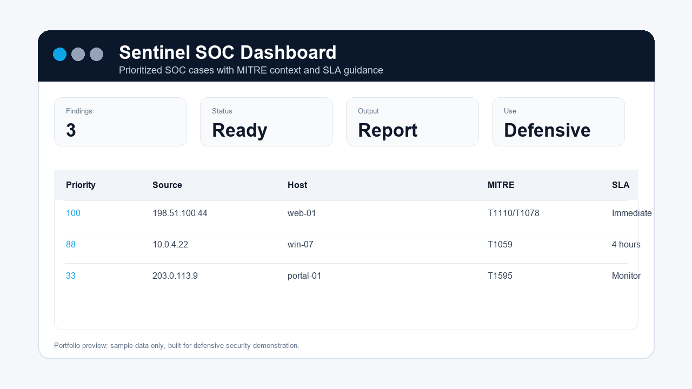

# Sentinel SOC Dashboard


[](https://github.com/Khanu123/sentinel-soc-dashboard/actions/workflows/tests.yml)




## Employer Review

| Area | Evidence |
| --- | --- |
| Target role | SOC Analyst / Security Operations |
| Strongest proof | MITRE mapping, severity scoring, false-positive notes, exportable incident report |
| Start here | [docs/examples/example_soc_report.md](docs/examples/example_soc_report.md) |
| Deeper review | [docs/employer-review.md](docs/employer-review.md) |
| Roadmap | [docs/roadmap.md](docs/roadmap.md) |

Sentinel SOC Dashboard is a defensive security project that turns raw alert data into prioritized analyst cases. It is designed to show practical SOC thinking: grouping related alerts, mapping MITRE ATT&CK context, scoring severity, recording analyst notes, handling possible false positives, and exporting reports that a junior analyst could use during triage.

## Why This Project Matters

SOC teams do not need another noisy alert list. They need clear prioritization, evidence, next actions, and a way to explain why a case should be escalated or monitored. This project demonstrates that workflow in a safe synthetic lab.

This is the project I would lead with in interviews because it shows:

- Practical blue-team mindset.
- Python automation beyond basic scripts.
- MITRE ATT&CK awareness.
- Severity and SLA-based triage.
- False-positive review habits.
- Exportable reports for analyst and stakeholder communication.
- Tests and sample data that make the project easy to evaluate.

## Extended validation and investigation

The default correlation now uses fixed 30-minute windows anchored to the first event. Missing source/host identities stay separate. Naive timestamps are interpreted as UTC; explicit timezone offsets are normalised. `triage(..., window_minutes=None)` is an unbounded comparison mode, with the same missing-identity safeguard.

A deterministic 1,014-alert exercise covers repeated daily sessions, shuffled input, incomplete identities, approved scanning, and a suspicious login sequence. Local results: **10/10 exercise checks and 34/34 unit tests**. These counts are regression coverage, not operational detection accuracy or a live-platform claim.

- [Investigation: approved scanner versus suspicious login](docs/validation/investigation.md)
- [Generated validation results](docs/validation/extended-results.json)
- Reproduce: `python scripts/validate_extended.py`

Known limits include false-positive prioritisation (the approved scanner still scores 100), fixed-window boundaries, and simplified tactic-to-technique mappings. No live Microsoft Sentinel integration is claimed.

## Current Capabilities

- Loads safe synthetic SOC alert data from JSON.
- Groups alerts by source IP and affected host within fixed 30-minute windows.
- Scores cases using top severity, alert volume, and tactic diversity.
- Maps tactics to MITRE ATT&CK techniques.
- Adds analyst notes and false-positive handling guidance.
- Tracks open and closed alert counts inside each case.
- Extracts simple indicators of compromise from sample alerts.
- Exports HTML, CSV, JSON, and Markdown incident reports.
- Includes unit tests for scoring, MITRE mapping, notes, false-positive handling, and sample data loading.

## Example Analyst Output

```text
Loaded 8 alerts.
Created 5 prioritized cases.
HTML report: docs/examples/soc_report.html
CSV report: docs/examples/soc_cases.csv
JSON report: docs/examples/soc_cases.json
Markdown report: docs/examples/example_soc_report.md
```

Example case fields:

| Field | Purpose |
| --- | --- |
| `priority` | Sorts the analyst queue by urgency |
| `mitre` | Shows ATT&CK context for investigation |
| `sla` | Gives the response expectation |
| `analyst_notes` | Explains what to validate next |
| `false_positive_handling` | Forces a check before over-escalation |
| `recommended_action` | Gives the next triage step |

## Quick Start

Python 3.10+ is required; there are no third-party runtime packages.

```bash
python -m venv .venv
# Windows PowerShell
.venv\Scripts\Activate.ps1
# macOS / Linux: source .venv/bin/activate
python -m pip install .
python -m sentinel_soc_dashboard.cli --alerts sample_data/alerts.json
python -m unittest discover -s tests -v
```

The sample generates five cases from eight alerts. All report paths default to the current directory; use `--html`, `--csv`, `--json`, and `--markdown` to select output files. Pass `--config config.example.json` for the supplied scoring example. Supply an explicit input path when running outside the checkout.

### Input quality and contrasting investigations

[Follow the complete input-to-report walkthrough](docs/validation/walkthrough.md), including suspicious activity, approved maintenance, and an unresolved case.

- Strict input validation reports row-specific problems instead of silently assigning unknown severities zero weight.
- Exact normalised duplicates are removed and counted; `--keep-duplicates` retains them for comparison.
- Invalid rows fail a normal run. `--skip-invalid` explicitly enables partial loading; `--diagnostics input-quality.json` records accepted, duplicate, and rejected counts and row-level reasons.
- Reports escape alert-derived HTML. This remains a local lab rather than a production ingestion service.

```bash
python scripts/validate_extended.py
python scripts/validate_scenarios.py
python -m sentinel_soc_dashboard.cli --alerts sample_data/investigation_scenarios.json --skip-invalid --diagnostics input-quality.json
```

The scenario input deliberately contains invalid rows: 15 rows become 11 accepted alerts, one removed duplicate, and three diagnosed rejections. Review [scenario results](docs/validation/scenario-results.json) for the three separate cases. The decisions are authored exercise interpretations, not automatic classifications.

## How It Helps a SOC Analyst

1. A raw stream of alerts is loaded from `sample_data/alerts.json`.
2. Alerts are normalized into consistent Python objects.
3. Related alerts are grouped by source IP and affected host.
4. Each group becomes a case with severity, volume, and MITRE context.
5. The tool adds analyst notes, false-positive checks, SLA guidance, and recommended actions.
6. Reports are exported so the findings can be reviewed, shared, or attached to a case record.

## Sample Data

The sample dataset is synthetic and safe. It includes examples such as:

- SSH brute-force followed by successful login.
- Encoded PowerShell and suspicious network activity.
- Web scanner activity that may be benign.
- Account discovery and possible archive staging.
- Blocked obfuscated script execution.

No real customer data, credentials, exploit code, or live scanning is included.

## Documentation

- [Example HTML Report](docs/examples/soc_report.html)
- [Example Markdown Report](docs/examples/example_soc_report.md)
- [Architecture](docs/architecture.md)
- [Case Study](docs/case-study.md)
- [How I Built a SOC Alert Triage Tool](docs/how-i-built-soc-alert-triage-tool.md)
- [Interview Notes](INTERVIEW_NOTES.md)
- [Roadmap](ROADMAP.md)

## Skills Demonstrated

- Python data processing.
- Defensive security automation.
- SOC alert triage workflow.
- MITRE ATT&CK mapping.
- Risk scoring and SLA logic.
- Security reporting.
- Unit testing.
- GitHub Actions.
- Clear technical documentation.

## Responsible Use

This project is defensive. It analyzes provided alert data and does not perform scanning, exploitation, credential attacks, or intrusive actions. All sample data is synthetic and intended for learning, portfolio review, and interview discussion.

